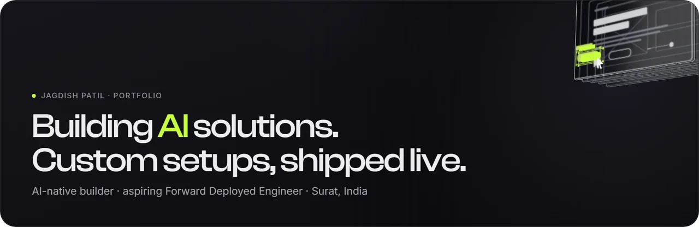
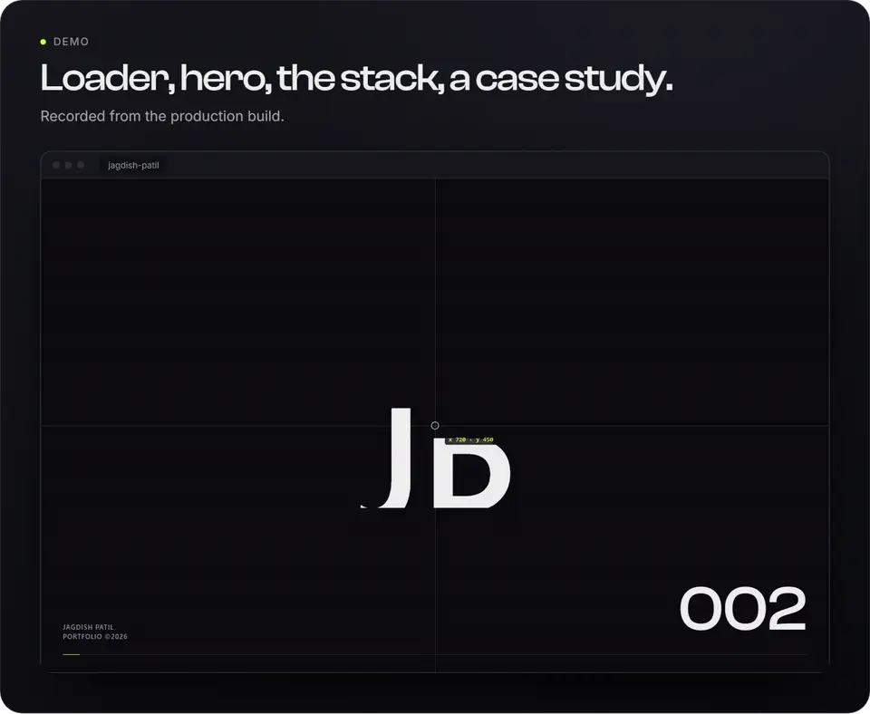
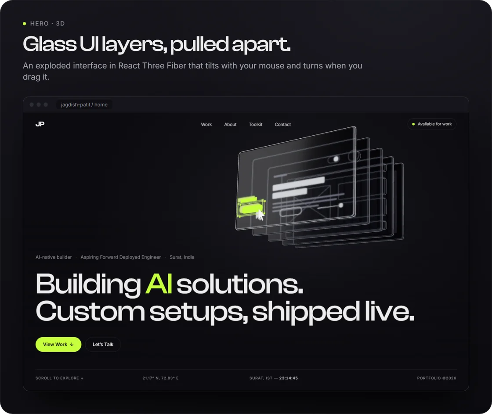
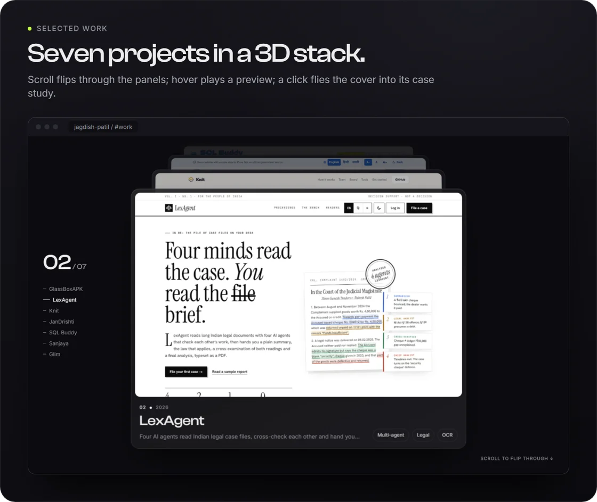
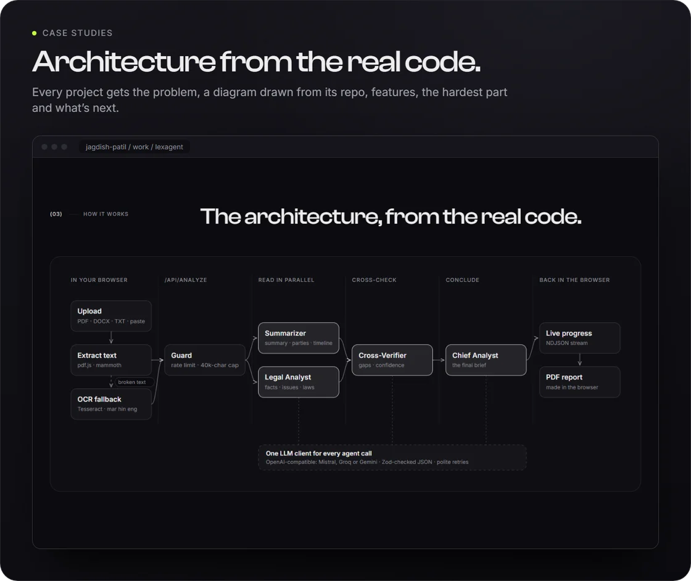
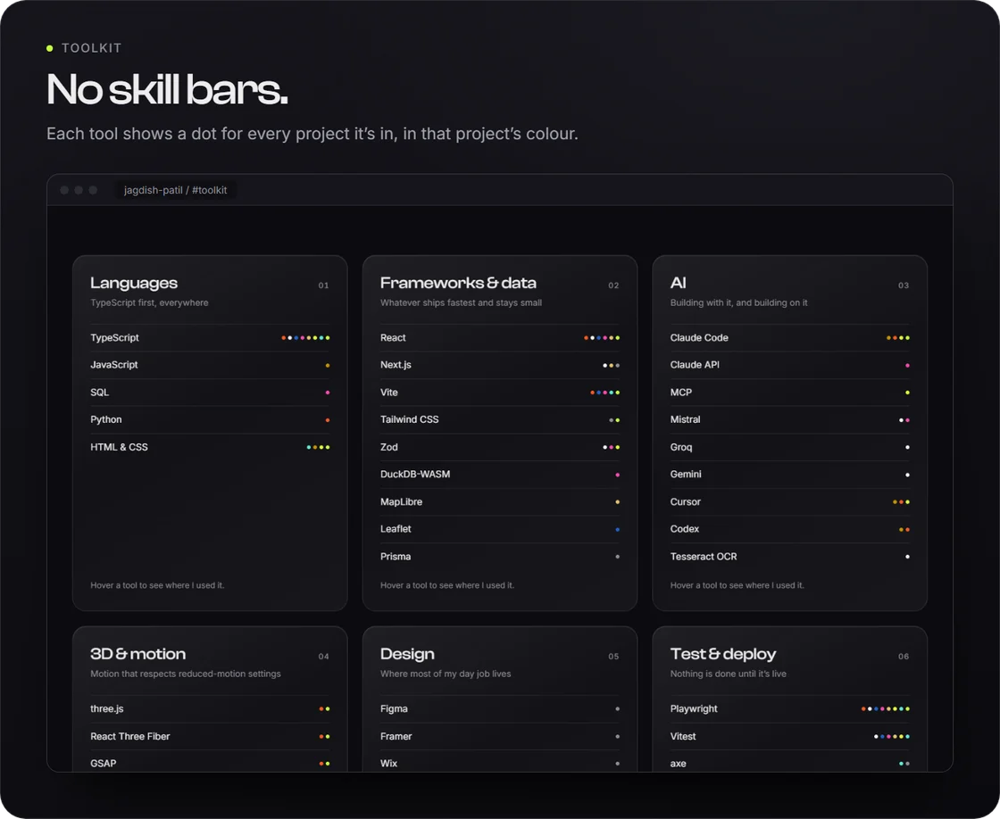
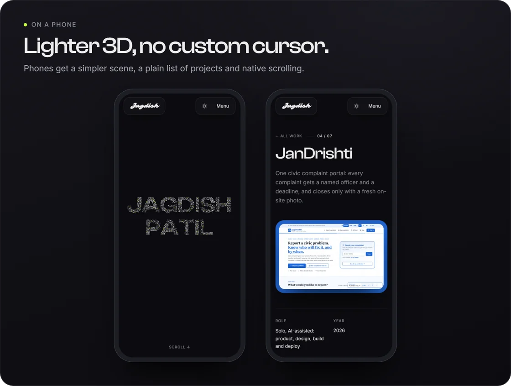

<p align="center">
  
</p>

<p align="center">
  <b>The portfolio of Jagdish Patil</b>: an AI-native builder and aspiring Forward Deployed Engineer in Surat, India.<br>
  A 3D site with a custom cursor, a pinned stack of glass project cards and a full case study for each of eight live projects.
</p>

<p align="center">
  <a href="https://jagdishpatil.vercel.app"></a>
  
  
  
  
  
  
  
</p>

<p align="center">
  <b><a href="#-see-it">See it</a></b> ·
  <b><a href="#-whats-inside">What's inside</a></b> ·
  <b><a href="#-scores">Scores</a></b> ·
  <b><a href="#-edit-the-content">Edit the content</a></b> ·
  <b><a href="#-run-it">Run it</a></b> ·
  <b><a href="#-deploy">Deploy</a></b>
</p>

---

## 🎬 See it

<p align="center">
  <a href="docs/readme/demo.mp4"></a>
</p>
<p align="center"><sub>Recorded from the production build. <a href="docs/readme/demo.mp4">MP4</a> · <a href="docs/readme/demo.gif">GIF</a></sub></p>

<table>
  <tr>
    <td width="50%"></td>
    <td width="50%"></td>
  </tr>
  <tr>
    <td width="50%"></td>
    <td width="50%"></td>
  </tr>
</table>

<p align="center"></p>

---

## ✨ What's inside

| | |
|---|---|
| ⏱️ **Loader** | Counts 000 → 100 next to a large “JP”, then flies the initials into the nav logo as the curtain lifts. About 1.8 s. |
| 🧊 **3D hero** | An interface pulled apart into its design layers (grid, wireframe, type, components, a selected lime button), as glass panes in React Three Fiber. It tilts with the mouse and turns when you drag it. |
| 🖱️ **Custom cursor** | A dot and a lagging ring with five states: links, “View →” on cards, “Drag” on the scene, a text caret sized to the text, and the native I-beam in inputs. Uses `mix-blend-mode: difference`. Off on touch screens; no lag with reduced motion. |
| 🃏 **Selected work** | On desktop, a pinned 3D stack: scrolling brings the panels forward one at a time. Hover tilts the panel and plays a short preview. A click flies the cover into the case study (a GSAP Flip-style shared-element transition). Phones get a plain list. |
| 📄 **Case studies** | One page per project: the problem, what I built, an architecture diagram drawn as inline SVG from the project's real code, features with screenshots (click to enlarge), the hardest part with the actual code, and what I'd do next. |
| 🧰 **Toolkit** | Tools in six groups. No skill bars: each tool shows a dot for every project it's in, in that project's colour. |
| ✉️ **Contact** | Copy-email button with a “copied” state and toast, LinkedIn, GitHub, and the live time in Surat. |
| 🔀 **Transitions** | A lime-then-black panel wipe between pages (about 600 ms), SplitText line reveals and subtle image parallax, all on one easing curve in [`src/lib/motion.ts`](src/lib/motion.ts). |

Every word about a project comes from that project's own README and code. Projects: [GlassBoxAPK](https://github.com/jagdish3135/glassboxapk), [LexAgent](https://github.com/jagdish3135/lexagent), [Knit](https://github.com/jagdish3135/knit), [JanDrishti](https://github.com/jagdish3135/jandrishti), [SQL Buddy](https://github.com/jagdish3135/sql-buddy), [Sanjaya](https://github.com/jagdish3135/sanjaya), [Glim](https://github.com/jagdish3135/glim) and [Calculator 2.0](https://github.com/jagdish3135/Calculator-2.0).

---

## 📊 Scores

Lighthouse 12 on the production build (`npm run lighthouse`), 30 Oct 2026:

| Page | Form | Performance | Accessibility | Best practices | SEO |
|---|---|:-:|:-:|:-:|:-:|
| Home | Desktop | **98** | **100** | **100** | **100** |
| LexAgent case study | Desktop | **99** | **100** | **100** | **100** |
| Home | Mobile | 90 | 100 | 100 | 100 |
| LexAgent case study | Mobile | 90 | 100 | 100 | 100 |

<details>
<summary><b>How it stays fast and accessible</b></summary>
<br>

- **Code-splitting.** three.js loads in its own chunk while the loader runs, so the headline never waits for it. Each case study is its own 2–3 KB chunk. Framer Motion's features load after first paint (`LazyMotion`).
- **No drei.** The scene's fat lines, rounded boxes and studio lighting are built straight on three.js ([`src/three/primitives.tsx`](src/three/primitives.tsx)).
- **A still image when 3D won't run well.** Reduced motion, no WebGL, a software renderer (no GPU), or a low-end phone all get a 25 KB poster instead of the scene. The canvas stops rendering when it's off screen or the tab is hidden.
- **Images.** AVIF with WebP fallback, an 800 px version for phones, lazy loading. Preview videos load only on hover.
- **Fonts.** Clash Display and Inter are self-hosted, and the heading font is preloaded.
- **Accessibility.** Real HTML text over the canvas, never text drawn in WebGL. Visible focus everywhere, every card reachable by keyboard (Tab brings a card forward in the stack), a skip link, AA contrast and labelled controls.

</details>

---

## ✏️ Edit the content

Everything you'd change lives in [`src/data/`](src/data):

| File | What's in it |
|---|---|
| [`site.ts`](src/data/site.ts) | Name, email, location, links, the site URL, and the résumé path (hidden while `null`) |
| [`projects.ts`](src/data/projects.ts) | Every project card: name, pitch, year, role, tags, stack, brand colour, links, media |
| [`case-studies/<slug>.ts`](src/data/case-studies) | Each case study: problem, what I built, the diagram, steps, features, hardest part, next steps |
| [`toolkit.ts`](src/data/toolkit.ts) | Tool groups and where each tool is used |

<details>
<summary><b>Add a project</b></summary>
<br>

1. Add an entry to `projects.ts` and a `case-studies/<slug>.ts` file.
2. `node scripts/capture-work.mjs <slug>`: desktop and phone screenshots of the live site.
3. `node scripts/capture-previews.mjs <slug>`: the 7-second hover preview (MP4 + WebM).
4. `node scripts/import-media.mjs <slug> <image> <name>`: feature screenshots from the project's repo.
5. `npm run og`: share images for every page.

</details>

---

## 🚀 Run it

Needs Node 20+.

```bash
npm install
npm run dev          # http://localhost:5220
npm run build        # type check, build, then per-page HTML, sitemap and robots.txt
npm run test:e2e     # Playwright on the production build, desktop and phone
```

<details>
<summary><b>All scripts</b></summary>
<br>

| Command | What it does |
|---|---|
| `npm run dev` | Dev server on port 5220 |
| `npm run build` | `tsc`, `vite build`, then [`scripts/prerender.mjs`](scripts/prerender.mjs): a head (title, description, canonical, Open Graph, JSON-LD) for every page, plus `sitemap.xml` and `robots.txt` |
| `npm run test:e2e` | 29 Playwright checks: the loader hands over, every card opens its case study (click on phones, keyboard on desktop), outside links are valid and respond, reduced motion gets the poster, copying the email works |
| `npm run lighthouse` | Lighthouse scores for the build served on port 4173 (`npx vite preview --port 4173`) |
| `npm run og` | Share images (1200×630) for every page into `public/og/` |
| `node scripts/check-pages.mjs` | Opens every case study at desktop and phone size; reports console errors, broken images and sideways scroll |
| `node docs/readme/make-media.mjs` | Rebuilds this README's banner, cards and demo (needs ffmpeg) |

</details>

<details>
<summary><b>Project layout</b></summary>
<br>

```
src/
  components/   Cursor, Loader, Nav, MagneticButton, ProjectCard, ArchDiagram, GlassStack, Media…
  sections/     Hero, About, WhatIDo, Work, Toolkit, Contact
  pages/        Home, ProjectPage (/work/:slug)
  three/        Scene3D, PanelStack, primitives (the 3D hero)
  lib/          motion (easing and durations), smooth (Lenis), flight (shared-element transition),
                transition (panel wipe), device (scene tier), meta
  data/         site, projects, case-studies/, toolkit
scripts/        screenshots, previews, share images, prerender, Lighthouse, page checks
e2e/            Playwright tests
```

</details>

---

## 🌐 Deploy

It's a static site. On Vercel, import the repo with the default Vite settings; [`vercel.json`](vercel.json) serves each case study's own HTML and sends other routes to the app. If the address isn't `jagdishpatil.vercel.app`, change `url` in [`src/data/site.ts`](src/data/site.ts) (or set `SITE_URL` in the build environment) so canonical links, share images and the sitemap point to the right place.

---

## Credits

- **Type:** [Clash Display](https://www.fontshare.com/fonts/clash-display) by Indian Type Foundry (ITF Free Font License), and [Inter](https://rsms.me/inter/) by Rasmus Andersson (SIL Open Font License).
- **Screenshots and previews** are of my own projects, captured from their live sites and READMEs.
- Built with React, React Three Fiber, GSAP, Lenis and Framer Motion, with Claude Code as my co-pilot.
